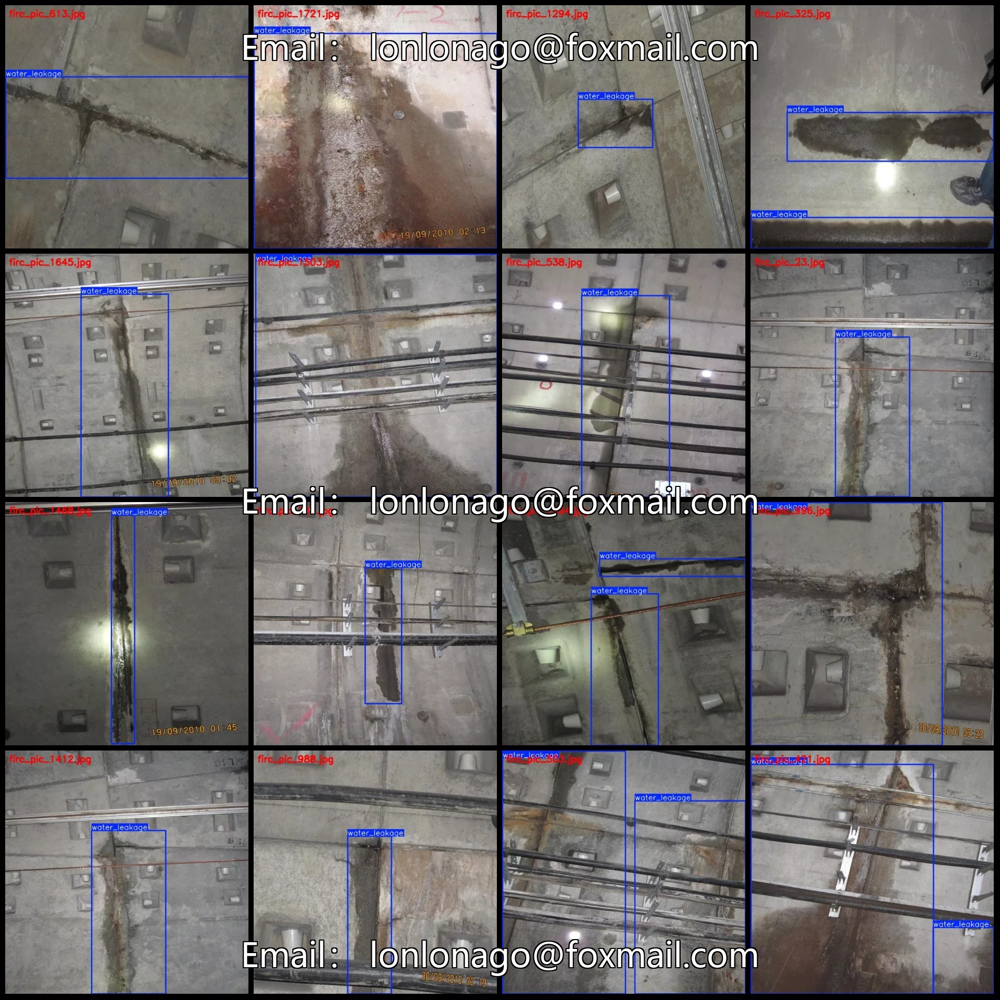
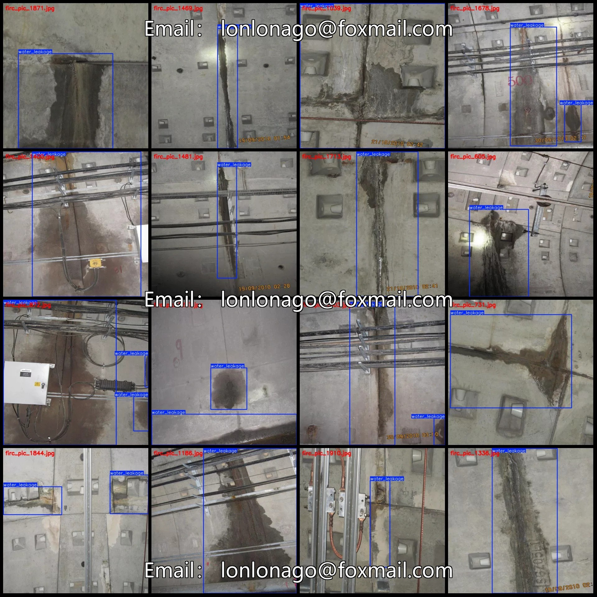
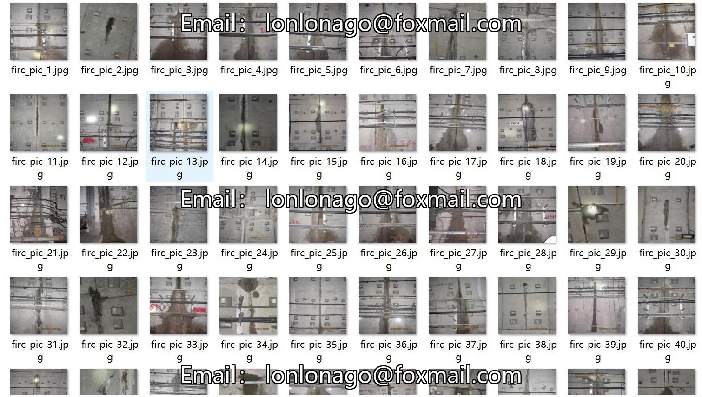
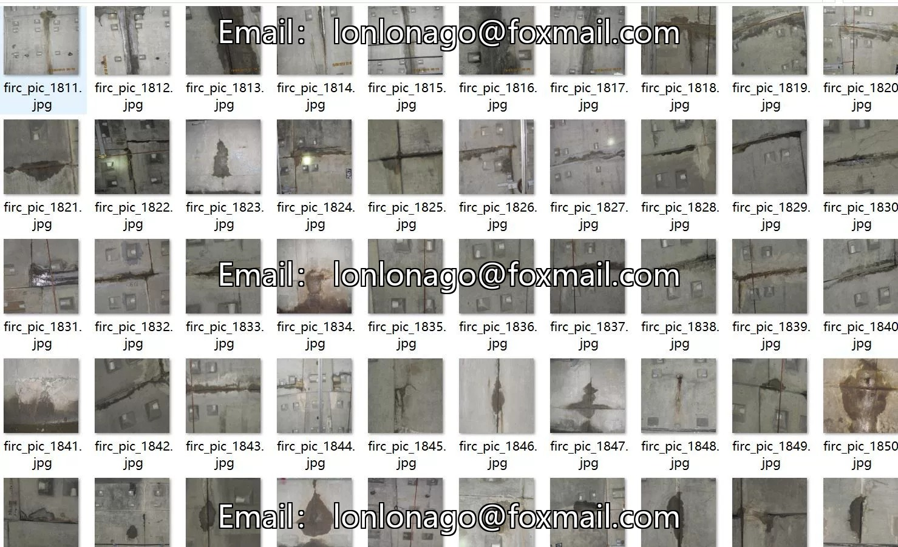
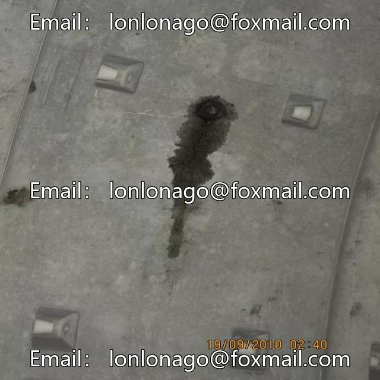
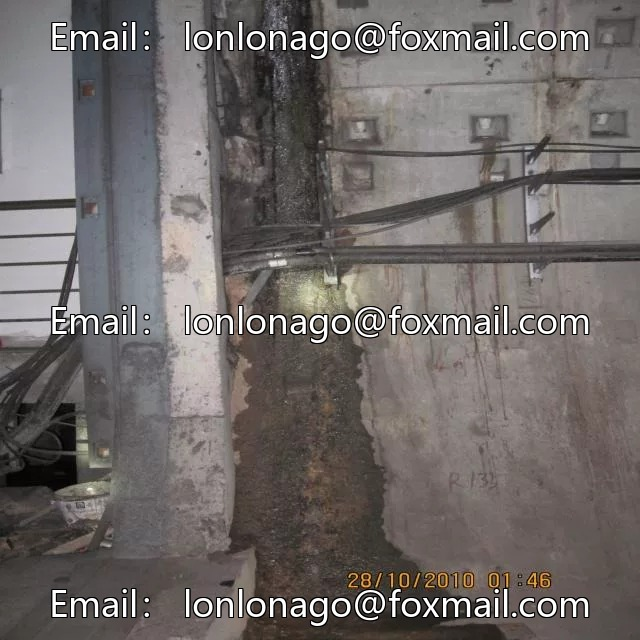
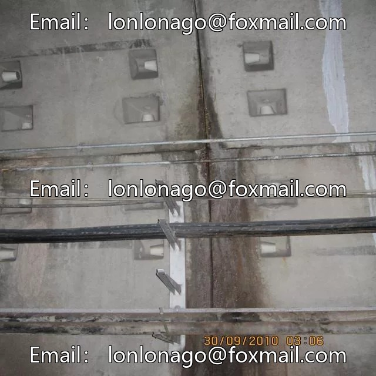

# Tunnel wall water leakage detection dataset in VOC+YOLO format, 1989 images

## Body

Water Leakage Detection Dataset in Pascal VOC+YOLO Format: 1989 Images, 1 Category

Warm Reminder: Due to the dataset's replicability, please confirm compliance with requirements before purchasing.

Dataset Format: Pascal VOC format + YOLO format (excluding split paths in txt files, only including jpg images and corresponding VOC format xml files and yolo format txt files)
Number of Images (JPG Files): 1989
Number of Annotations (XML Files): 1989
Number of Annotations (TXT Files): 1989
Number of Annotation Categories: 1
Annotation Category Name: ["water_leakage"]

Each category has a specified number of bounding boxes and image coverage.

Water Leakage Frames = 3274, occupying images = 1989
Total frames: 3274
Image resolution: 640x640
Labeling tool used: labelImg
Labeling rules: Draw a rectangle around the category.
Important note: The dataset does not have splits for training, validation, and testing; you need to do this yourself.
Special statement: This dataset does not guarantee the accuracy of the trained models or weight files.

## Images

## Payment

Here is a pay link on Stripe ( https://buy.stripe.com/3cs8yP7sY87d0vu9AB ). Please contact me lonlonago@foxmail.com after funding $89, and I will send you a complete data files , thank you!

